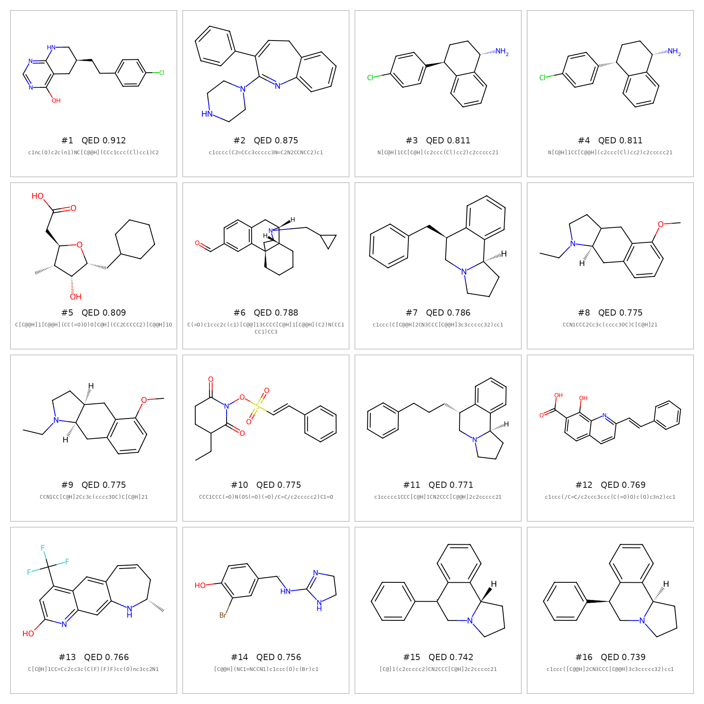
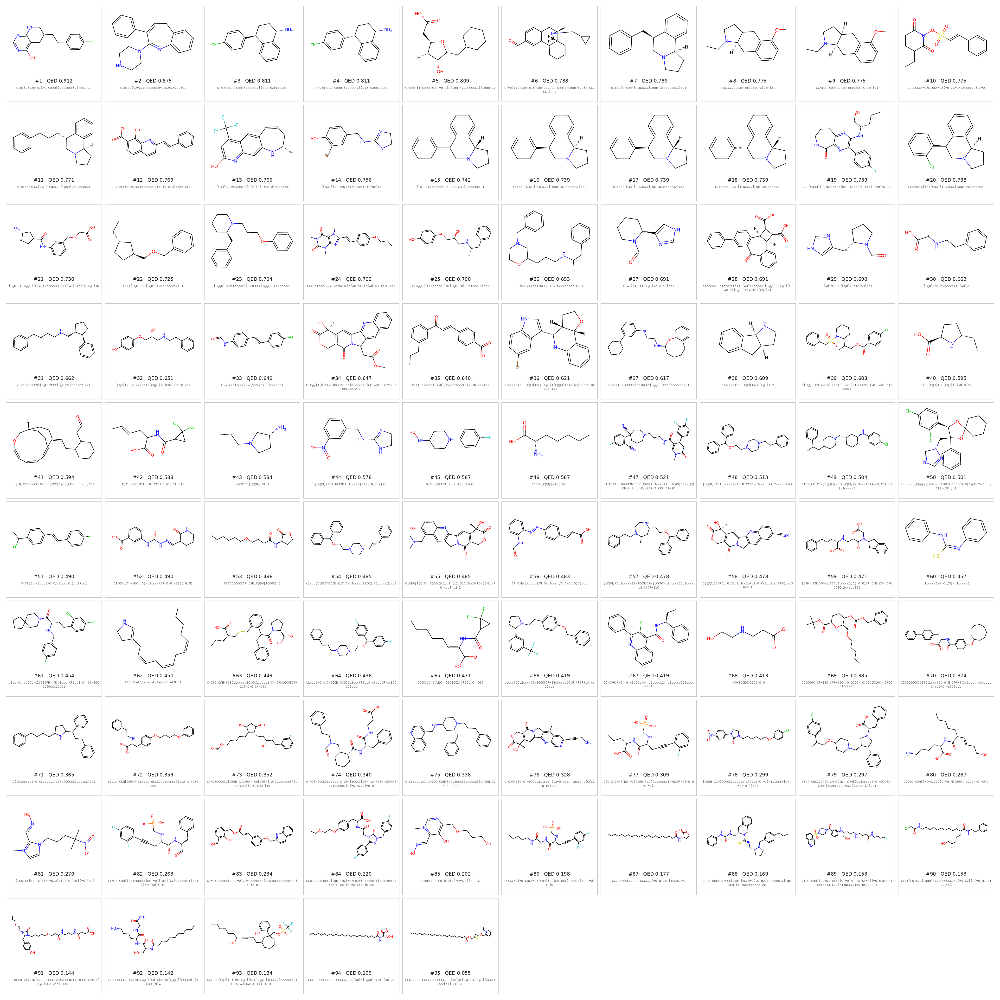
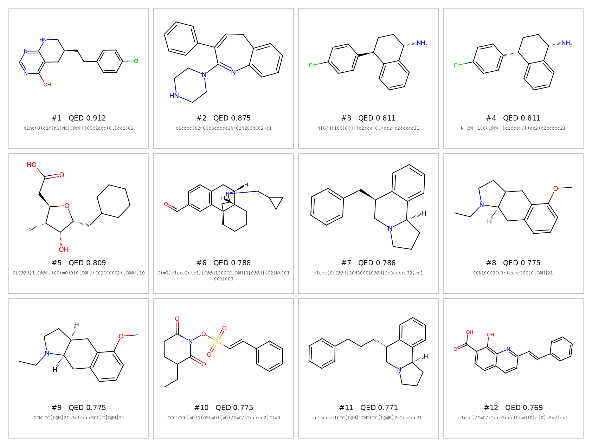

# MolGPT：基于 GPT-2 的分子生成

使用 GPT-2 架构的 Transformer 模型进行分子生成。

---

## 生成结果展示

### Top 16 分子（按 QED 排序）

### 完整分子库（95 个去重后的有效分子）

### Top 12 分子结构式

**[→ 查看可交互的 3D 构象](https://chloelincc.github.io/MolGen-GPT2/results/molecules_3d.html)**（可旋转、缩放；构象由 RDKit ETKDGv3 嵌入并经 MMFF94 优化）

---

## 结果统计
---

## 结果统计

| 指标 | 数值 |
|------|------|
| 有效分子数 | 105 |
| 去重后分子数 | 95 |
| 唯一率 | 90.5% |
| 最高 QED | **0.912** |
| Top 16 平均 QED | **0.795** |
| 手性中心指定率 | 85%（135 / 158） |

本版本使用带立体化学标注的 ChEMBL 数据训练，生成分子保留手性信息。
生成分子共含 158 个手性中心，其中 135 个给出了明确构型；
仍有 10 个分子存在手性中心部分未指定的情况。

---

## 示例分子

| # | SMILES | QED | logP | MW |
|---|--------|-----|------|-----|
| 1 | `c1nc(O)c2c(n1)NC[C@@H](CCc1ccc(Cl)cc1)C2` | 0.912 | 3.05 | 289.8 |
| 2 | `c1cccc(C2=CCc3ccccc3N=C2N2CCNCC2)c1` | 0.875 | 3.26 | 303.4 |
| 3 | `N[C@H]1CC[C@H](c2ccc(Cl)cc2)c2ccccc21` | 0.811 | 4.27 | 257.8 |

---

## 模型配置

| 参数 | 值 |
|------|-----|
| Transformer 层数 | 4 |
| 隐藏层维度 | 512 |
| 注意力头数 | 8 |
| 参数量 | 12.7M |
| 训练数据 | 20,000 分子（含立体化学） |
| 训练轮数 | 20 epoch |

---

